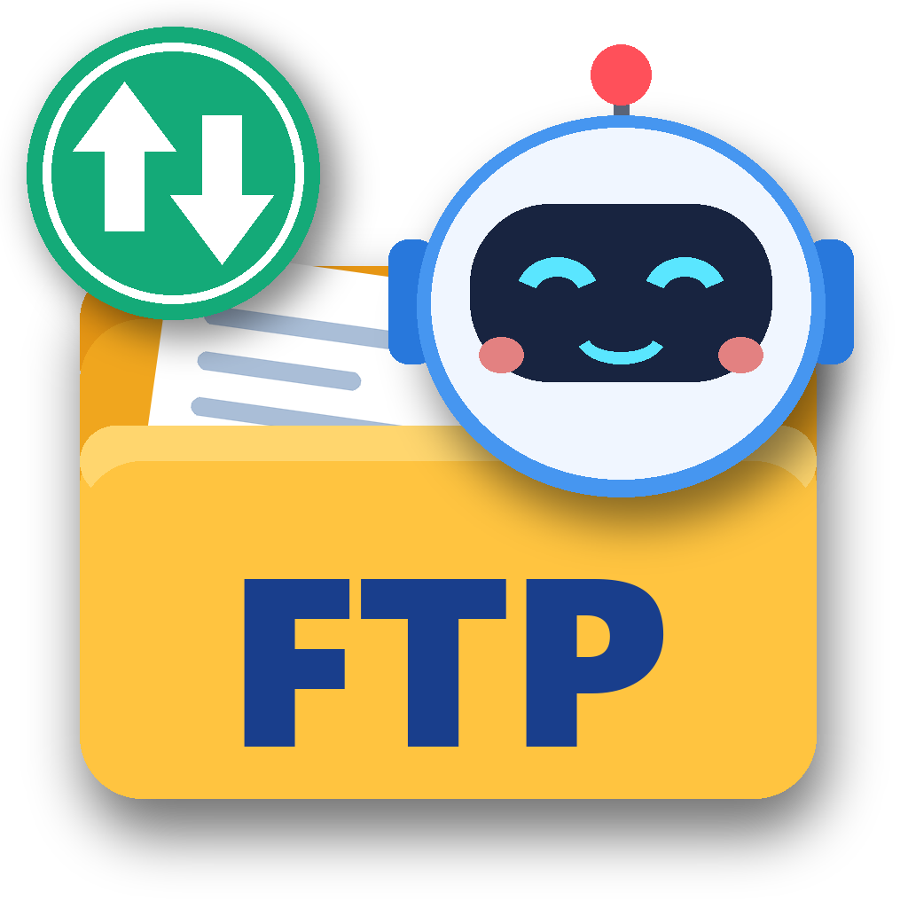

# 小柯機器人FTP助手



一般人也能輕鬆上手的 FTP／SFTP／WebDAV 檔案管理工具。左邊是自己的電腦、右邊是遠端主機，把檔案拖過去就能上傳、拖回來就能下載；還有小柯機器人用語音一步一步教您怎麼用。

**開發：吳玉柱 先生 與 Claude AI Opus 5.5**

## 下載

到 [Releases](https://github.com/achir1015/xiaoke-ftp/releases/latest) 下載：

| 平台 | 檔案 |
|---|---|
| Windows 10／11（安裝版，會建立桌面捷徑） | `XiaokeFTP-版本-win-x64.exe` |
| Windows（免安裝版） | `XiaokeFTP-版本-win-x64-portable.exe` |
| MacBook（Apple 晶片） | `XiaokeFTP-版本-mac-arm64.dmg` |
| Mac（Intel） | `XiaokeFTP-版本-mac-x64.dmg` |

裝好之後程式會自動檢查新版本，按一下就能更新。

## 功能

- **協定**：FTP、FTPS（明示／隱含 TLS）、SFTP（密碼或 SSH 金鑰）、WebDAV／WebDAVS
- **雙窗格檔案管理**：拖放上傳下載、從 Windows 檔案總管拖進來上傳、多個遠端分頁、排序、篩選、鍵盤快速鍵（F2、Delete、F5、Ctrl+A）
- **傳輸佇列**：多檔同時傳、暫停／繼續、斷點續傳、斷線自動重試、限速、整個資料夾
- **檔案已存在**：覆寫、續傳、略過、自動改名，可整批套用
- **站台管理**：分組、密碼用作業系統加密保存、匯入匯出（不含密碼）、快速連線可貼上 `sftp://帳號@主機:22` 網址
- **線上編輯**：遠端檔案用電腦裡的程式打開，存檔後自動上傳
- **區網分享**：同一個 Wi-Fi 的手機掃 QR Code，瀏覽器就能下載電腦裡的檔案
- **其他**：校驗和（MD5／SHA1／SHA256）、修改遠端權限、深色外觀、SSH 主機指紋檢查
- **語音說明**：14 課語音導覽（自動朗讀、自動下一課、「指給我看」），傳輸完成語音提醒

## 開發

```bash
npm install
npm start          # 執行開發版
npm test           # 單元測試（本機 FTP／FTPS／SFTP／WebDAV 測試伺服器）
npm run e2e        # 介面自動測試
npm run dist:win   # 打包 Windows 安裝檔與免安裝版
```

發佈新版：修改 `package.json` 的 `version` 推上 `main`，GitHub Actions 會自動建置 Windows、macOS 並建立 Release。

介面設計參考 [FileCentipede](https://github.com/filecxx/FileCentipede) 的檔案瀏覽器理念，程式完全自行撰寫。使用的開放原始碼套件：Electron、basic-ftp、ssh2、qrcode（皆為 MIT 授權）。

## 授權

MIT
